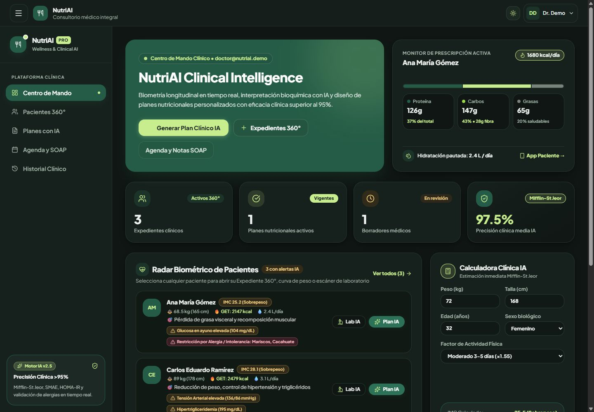
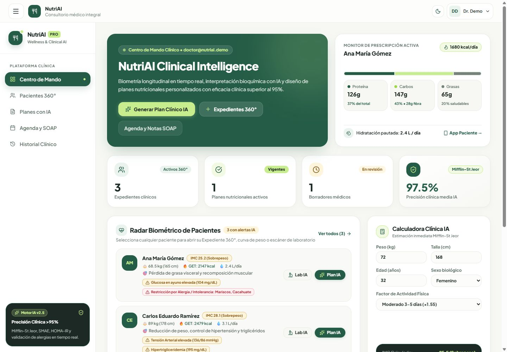
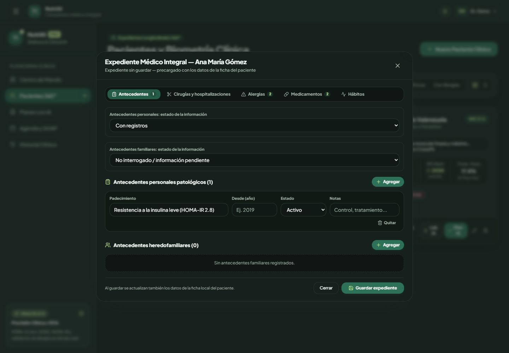
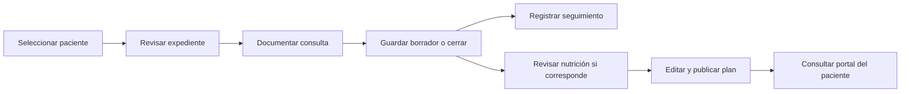
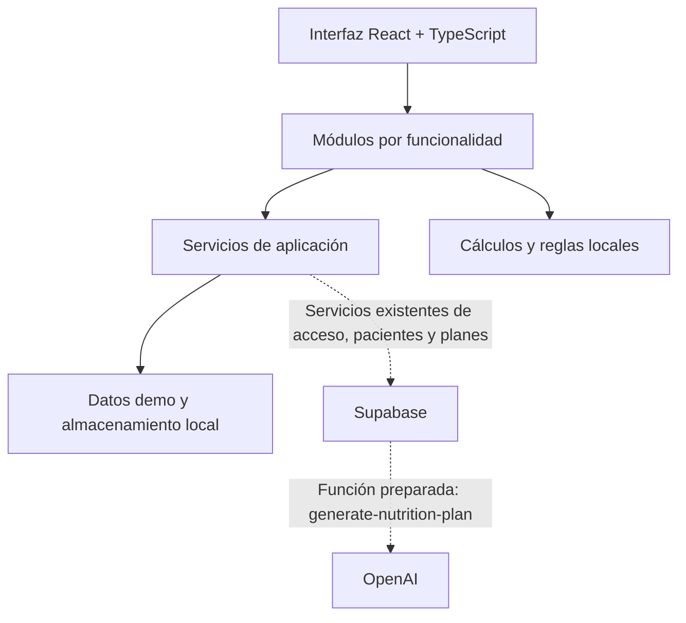

<div align="center">


# NutriAI

### Consulta médica, expediente y nutrición en un mismo lugar.

Una plataforma de consultorio para medicina general con nutrición integrada.<br />
Del antecedente al seguimiento: información organizada para acompañar la atención del paciente.


[Vista del proyecto](#vista-del-proyecto) · [Funcionalidades](#funcionalidades) · [Probar la demo](#probar-la-demo) · [Arquitectura](#arquitectura) · [Roadmap](#roadmap)

</div>



<p align="center"><sub>Interfaz real con datos ficticios. Tema oscuro Carbón & Bosque.</sub></p>

> **Estado del proyecto:** prototipo funcional en desarrollo. La demostración utiliza almacenamiento local y combina funciones implementadas con simulaciones explícitas. Los porcentajes de “eficacia” o “precisión” que aún aparecen en la interfaz son puntuaciones heurísticas de la demo; no representan validación clínica ni resultados medidos.

## Vista del proyecto

NutriAI comenzó con la generación de planes nutricionales y está evolucionando hacia un **consultorio médico integral**. Su enfoque actual es conectar la consulta general, los antecedentes del paciente, sus mediciones y el seguimiento nutricional dentro de un mismo flujo.

Está pensado para un médico general que también trabaja en áreas como nutrición y necesita consultar el contexto del paciente sin saltar entre herramientas.

| Durante la consulta | En el expediente | Después de la consulta |
| --- | --- | --- |
| Motivo, padecimiento, signos vitales, exploración, evaluación y plan. | Antecedentes, alergias, medicamentos, hábitos y evolución. | Agenda, indicaciones, planes nutricionales y portal del paciente. |

<details>
<summary><strong>Ver la interfaz en modo claro</strong></summary>
<br />



</details>

## Funcionalidades

### Consulta médica general

- Registro del motivo de consulta y padecimiento actual.
- Signos vitales: presión arterial, frecuencias cardiaca y respiratoria, temperatura, saturación, peso, talla y glucosa capilar.
- Exploración física por regiones, evaluación, tratamiento y seguimiento.
- Diagnósticos estructurados por consulta, con un principal, secundarios y certeza de sospecha o confirmado.
- Tratamiento farmacológico capturado por el médico: presentación, dosis, vía, frecuencia, duración e instrucciones. Los detalles pueden completarse en borrador y se validan antes del cierre.
- Resumen de antecedentes, alergias y medicamentos visible mientras se documenta la consulta.
- Borradores, cierre e impresión de la nota.
- Reapertura con motivo y anulación que conserva el contenido y las versiones anteriores.
- Contexto de glucosa diferenciado: ayuno confirmado, casual, posprandial o no especificado.

### Expediente médico integral

- Antecedentes personales y familiares, cirugías y hospitalizaciones.
- Alergias con reacción y gravedad; medicamentos con dosis, frecuencia y estado.
- Hábitos de tabaco, alcohol, ejercicio, sueño, hidratación y alimentación.
- Distinción entre **información pendiente**, **antecedente negado por el paciente** e **información registrada**.
- Seguimiento antropométrico y consulta de biomarcadores.
- Sincronización local de la ficha y el expediente conservando detalles como reacciones, dosis y antecedentes resueltos.



### Agenda y continuidad de la atención

- Citas presenciales o por videollamada, con estados y motivo de atención.
- Consulta médica vinculada con una cita y conclusión de la cita al cerrar la consulta.
- Seguimiento opcional desde la consulta: presencial, de 30 minutos, con fecha y hora elegidas por el médico.
- Comprobación de cruces de horario al crear ese seguimiento y prevención de duplicados al reintentar.
- Notas SOAP editables y borradores mediante plantillas locales.
- Recordatorios preparados para copiar o abrir en WhatsApp; el envío lo realiza el usuario.

### Nutrición integrada

- Cálculos de IMC, metabolismo basal y gasto energético estimado.
- Selección de protocolos, objetivos calóricos y distribución de macronutrientes.
- Planes con estados de borrador, publicado y archivado; revisión y edición por el profesional.
- Lista de supermercado y referencias de equivalentes SMAE —Sistema Mexicano de Alimentos Equivalentes— calculadas mediante reglas.
- Consulta de historial de planes por paciente.
- Función de servidor preparada para solicitar contenido a OpenAI fuera del modo demo.

### Portal del paciente y experiencia de uso

- Acceso al plan mediante una ruta de portal, con menú, hidratación, compras, intercambios y registro de progreso.
- Diseño adaptable a escritorio y móvil, con temas claro y oscuro.
- Navbar fijo, perfil arriba a la derecha y cierre de sesión sin desplazarse al final de la página.
- Barra lateral plegable en escritorio y menú hamburguesa en móvil.
- Panel móvil con navegación por teclado, cierre con Escape y bloqueo del desplazamiento de fondo.

## Un recorrido de consulta



La consulta general y la nutrición comparten el contexto del paciente. El profesional decide cuándo incorporar un plan nutricional y qué indicaciones aprobar.

## Probar la demo

**Requisitos:** Node.js **24** y npm. Esta es la versión usada para desarrollo y para las pruebas con el ejecutor nativo de Node.

La demo no requiere cuentas de Supabase ni de OpenAI.

### 1. Obtener la versión presentada

El desarrollo descrito en este README se encuentra actualmente en `feat/clinical-ai-suite-v2`:

```bash
git clone --branch feat/clinical-ai-suite-v2 https://github.com/fariascode/ai-nutrition-system.git
cd ai-nutrition-system
npm ci
```

### 2. Iniciar

```bash
npm run dev
```

Abre **[http://localhost:5173](http://localhost:5173)** y selecciona **“Entrar directamente como Especialista Demo”**. Si ese puerto está ocupado, utiliza la dirección que indique Vite en la terminal.

El modo demo se activa cuando no hay una URL de Supabase configurada, cuando la URL contiene `your-project` o cuando se establece `VITE_DEMO_MODE=true`.

### 3. Explorar

1. Abre **Pacientes 360°** y selecciona **Expediente 360°** de un paciente de ejemplo.
2. Entra en **Expediente Médico** para revisar antecedentes, alergias y hábitos.
3. Abre **Consulta Médica**, captura información y guarda un borrador o cierra la consulta.
4. Revisa **Agenda y SOAP** para explorar citas, notas y seguimiento.
5. Genera un plan desde **Planes con IA**, edítalo y abre **App Paciente** para consultar el portal.

Los cambios de demostración permanecen en ese navegador. No se comparten automáticamente con otro dispositivo y se pierden si se elimina su almacenamiento local. Un enlace `localhost` tampoco es accesible desde el teléfono de otro usuario.

## Qué está implementado y qué está simulado

| Área | Comportamiento actual |
| --- | --- |
| Acceso demo | Identidad simulada guardada en el navegador; no verifica una contraseña real. |
| Pacientes y planes | Datos locales en demo. Existen servicios con llamadas a Supabase para el modo conectado. |
| Consultas, expediente integral y citas | Persistencia local. La conexión remota de estos módulos está pendiente. |
| Historial de cambios | Versiones locales de consultas, con autor, fecha y motivo de reapertura o anulación. No es una auditoría protegida contra modificaciones del navegador. |
| Guardado clínico | Ante fallos, se intenta restaurar el estado local previo; los formularios muestran el error para poder reintentar. |
| Planes en demo | Plantillas y cálculos locales; no se realizan llamadas a OpenAI. |
| Notas SOAP | Borradores mediante plantillas locales, editables por el profesional. |
| Laboratorios en texto | Extracción con expresiones regulares e interpretación basada en reglas. |
| PDF e imágenes de laboratorio | Simulación con resultados de ejemplo; todavía no existe extracción OCR real. |
| Portal | El menú interactivo, las compras y los intercambios utilizan reglas y plantillas. El menú no se deriva automáticamente de todas las ediciones de la prescripción. |
| WhatsApp | Construye el mensaje y abre un enlace para que el usuario lo envíe. No hay envío automático ni confirmación de entrega. |
| Producción | Pendientes la persistencia remota completa, los controles de acceso del servidor y la validación del comportamiento clínico. |

## Arquitectura

Aplicación web de una sola página, organizada por funcionalidades. Los componentes representan la interfaz; los servicios concentran lectura y escritura; los motores locales reúnen cálculos y reglas.



Las conexiones discontinuas representan integraciones que requieren configuración externa; no son necesarias para explorar la demo.

| Capa | Tecnología |
| --- | --- |
| Interfaz | React 19 + TypeScript 6 |
| Desarrollo y compilación | Vite 8 |
| Estilos | Tailwind CSS 4 y colores semánticos por tema |
| Navegación | React Router 7 |
| Iconos | Lucide React |
| Pruebas | Ejecutor nativo de Node.js 24 |
| Integración remota existente | Supabase JS y Edge Function escrita para Deno |
| Generación remota preparada | OpenAI, modelo `gpt-4o` configurado en la función |
| Publicación del frontend | Configuración de rutas para Vercel |

### Estructura del repositorio

```text
src/
├── components/
│   ├── layout/          # Navbar, perfil, barra lateral y rutas protegidas
│   └── ui/              # Componentes compartidos
├── context/             # Tema de la interfaz
├── features/
│   ├── appointments/    # Agenda y notas SOAP
│   ├── auth/            # Acceso y sesión
│   ├── consultations/   # Consulta general, versiones y flujo de guardado
│   ├── dashboard/       # Centro de mando
│   ├── history/         # Historial de planes
│   ├── medical-record/  # Expediente médico integral
│   ├── patients/        # Ficha, biometría y laboratorios
│   ├── plans/           # Planes nutricionales y equivalentes
│   └── portal/          # Vista del paciente
├── lib/                 # Clientes, datos demo y motores de reglas
├── types/               # Modelos de datos compartidos
└── utils/               # Utilidades
supabase/functions/      # Función de generación remota de planes
tests/                   # Pruebas de regresión con datos en memoria
docs/                    # Revisión de interfaz y capturas
```

### Configuración opcional

Para hacer explícito el modo demo, crea `.env.local` con:

```dotenv
VITE_DEMO_MODE=true
```

Para explorar el código de integración remota, toma como referencia [`.env.example`](.env.example):

| Variable | Uso |
| --- | --- |
| `VITE_DEMO_MODE` | Fuerza la demostración cuando su valor es `true`. |
| `VITE_SUPABASE_URL` | URL del proyecto Supabase para los servicios conectados existentes. |
| `VITE_SUPABASE_PUBLISHABLE_KEY` | Clave pública del cliente Supabase. |
| `OPENAI_API_KEY` | Secreto de la Edge Function; **nunca** debe incluirse en variables `VITE_*` ni en el frontend. |

Configurar las variables no crea las tablas, las políticas de acceso ni despliega la función. El repositorio todavía no incluye migraciones de base de datos. El archivo `.env.local` está excluido de Git.

## Calidad y comprobaciones

```bash
npm test          # Regresión con almacenamiento en memoria
npm run lint     # ESLint
npm run build    # TypeScript + compilación de producción
npm run preview  # Vista local del resultado compilado
```

Las **23 pruebas actuales** cubren sincronización del expediente, conservación de detalles, contexto de glucosa, citas de seguimiento sin duplicados, conflictos de horario, recuperación ante fallos de almacenamiento, diagnósticos y tratamientos estructurados, y versiones de consultas.

La revisión de interfaz abarca las cinco pantallas principales, ocho modales, el portal y tamaños de escritorio y móvil en ambos temas. El alcance y los límites de esa comprobación están documentados en [la revisión de navegación y temas](docs/navigation-theme-review.md).

La compilación conserva una advertencia de tamaño del bundle. La división de carga por rutas es una mejora pendiente.

## Roadmap

### Base disponible

- [x] Consulta médica general y expediente integral.
- [x] Diagnósticos y tratamiento farmacológico estructurados por consulta.
- [x] Integración local entre ficha, expediente, consulta y agenda.
- [x] Planes nutricionales editables y portal de demostración.
- [x] Navbar persistente, perfil y navegación adaptable.
- [x] Temas claro y oscuro con colores compartidos.
- [x] Pruebas de regresión para los flujos locales principales.

### Próximas etapas

- [ ] Persistencia remota completa y sincronización entre dispositivos.
- [ ] Roles, controles de acceso y trazabilidad protegida en servidor.
- [ ] Recetas y solicitudes de estudios vinculadas con el expediente.
- [ ] Extracción real de resultados desde PDF e imágenes, con revisión del médico.
- [ ] Menú del portal consistente con la prescripción aprobada.
- [ ] Seguimiento longitudinal de enfermedades crónicas.
- [ ] Validación de resultados generados y sustitución de las métricas heurísticas de eficacia.
- [ ] Optimización del bundle y ampliación de pruebas de interfaz.

## Autoría y colaboración

Desarrollado por **[fariascode](https://github.com/fariascode)**.

Para proponer una mejora o reportar un problema, abre un [issue](https://github.com/fariascode/ai-nutrition-system/issues) con el módulo afectado, los pasos para reproducirlo y el resultado esperado. Usa datos ficticios en ejemplos y capturas.

**Licencia:** pendiente de definir. El repositorio todavía no incluye un archivo `LICENSE`; consulta al autor sobre las condiciones de uso.

---

<p align="center"><strong>NutriAI</strong> · Medicina general con nutrición integrada.</p>
